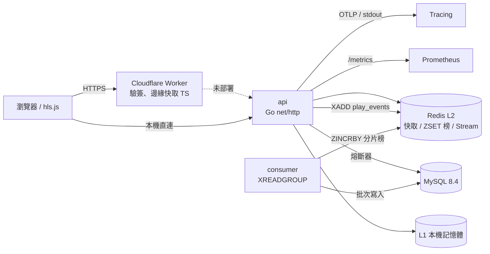

# vod-gateway

用 Go 寫的影片服務後端範例：影片與創作者 API、兩層快取、限流與熔斷降級、HLS 加密串流（AES-128 + 簽章網址 + 防盜鏈）、Redis Streams 非同步統計、可觀測性、壓測與 pprof 調校、Cloudflare 邊緣層。

這份 README 的數字全部來自本機實際量測，原始輸出都放在 `docs/` 與 `loadtest/results/`。沒做到、沒驗證的項目寫在最後一節「限制與沒做的事」。

## 架構



| 元件 | 說明 |
|---|---|
| `cmd/api` | HTTP API、HLS 簽章與金鑰服務、H5 播放頁、`/metrics`、`/debug/pprof` |
| `cmd/consumer` | 讀 Redis Stream，去重、批次寫 MySQL、更新排行榜，XAUTOCLAIM 接手卡住的訊息 |
| `cmd/seed` | 產生 200 萬以內的測試資料（預設 2000 創作者、50 萬影片，固定亂數種子） |
| `cmd/signurl` | 命令列簽網址，跨語言測試用（Go 簽、Worker 驗） |
| `edge/` | Cloudflare Worker（JS）：同樣的簽章驗證、Referer 白名單、TS 邊緣快取 |
| `deploy/cloudflare/` | Terraform：Cache Rules、WAF、Rate Limiting、Worker 路由 |

## 怎麼跑

需求：docker、ffmpeg 由腳本在容器裡跑，不用裝在本機。

```bash
scripts/make_hls.sh                      # 用 ffmpeg 產生 3 支測試影片（testsrc + 正弦波）切成 HLS，AES-128 加密
docker compose up -d --build             # mysql、redis、api、consumer
docker compose run --rm --entrypoint /app/seed api    # 灌 50 萬筆影片（約 1 分鐘）
open http://127.0.0.1:8090/              # H5 播放頁；影片 id 1~3 是 HLS 示範
```

常用指令：

```bash
scripts/gorun go test -race -count=1 ./...                           # 單元測試（golang 容器內執行）
scripts/gorun go test -tags integration -count=1 ./internal/integration   # 整合測試，用 compose 起的 MySQL 與 Redis
(cd e2e && npx playwright test --repeat-each=10)                     # 真瀏覽器播放與鑑權
loadtest/run.sh <標籤>                                                # k6 壓測 + GC 統計，結果存 loadtest/results/
scripts/explain_demo.sh                                              # EXPLAIN 前後對照
scripts/chaos_mysql.sh                                               # 流量中停 MySQL 看降級
```

所有埠都綁 127.0.0.1：api 8090、consumer 指標 8091、mysql 13306、redis 16379。

## API

| 端點 | 說明 |
|---|---|
| `GET /api/videos/{id}` | 影片詳情（走兩層快取） |
| `POST /api/videos` | 新增影片（`Authorization` 需帶 admin token） |
| `GET /api/creators/{id}`、`/api/creators/{id}/videos` | 創作者與其影片列表 |
| `GET /api/search?q=` | 搜尋影片標題（FULLTEXT ngram）與創作者名稱（前綴），平行查詢後合併 |
| `GET /api/rank/hot` | 熱門榜 |
| `POST /api/play-events` | 播放事件，寫入 Redis Stream，回 202 |
| `GET /api/me/history`、`GET/PUT/DELETE /api/me/favorites` | 播放紀錄與收藏。身分用 `X-User-Id` 標頭模擬，沒有做真實登入 |
| `POST /api/videos/{id}/play` | 發簽章過的 m3u8 網址 |
| `GET /hls/{id}/{file}`、`GET /key/{id}` | m3u8 / TS / AES 金鑰，皆需簽章 |

## 1. MySQL 索引與 EXPLAIN 前後對照

資料量 50 萬支影片、2000 位創作者。`scripts/explain_demo.sh` 每次拿掉再加回索引，各跑 3 次，原始輸出在 `docs/explain-demo.txt`。

| 查詢 | 沒有索引 | 有索引 | 倍數 |
|---|---|---|---|
| 創作者影片列表 `WHERE creator_id=? ORDER BY created_at DESC LIMIT 20` | 全表掃描 50 萬列 + filesort，**141 / 149 / 188 ms** | `idx_creator_created`，只讀 20 列，**0.13 ~ 0.19 ms** | 約 1000 倍 |
| 標題搜尋「露營 vlog 懶人包」 | `LIKE '%…%'` 全表掃描，掃到 40,494 列湊滿 20 筆才停，**18.5 ~ 24 ms** | FULLTEXT（ngram）布林模式片語，**0.9 ~ 1.3 ms** | 約 18 倍 |

注意：LIKE 的 18 ~ 24 ms 因為有 `LIMIT 20` 且符合的資料多，提早停止；搜尋詞很冷門時 LIKE 會掃完整張表，差距更大。這裡量的是這個詞的實際數字。

其他索引：`play_history (user_id, video_id)` 主鍵 + `idx_user_updated`（查最近播放）、`favorites` 主鍵（收藏冪等）、`creators.idx_name`（前綴搜尋）。整合測試會檢查查詢確實用到這些索引。

## 2. 快取：經典問題怎麼解

兩層：L1（本機 map，單一 RWMutex，隨機淘汰）+ L2（Redis）。每筆資料有「軟 TTL」（新鮮期）與「硬 TTL」（軟 TTL x 10，抖動後），軟 TTL 過了但硬 TTL 還在的值可以當舊值降級使用。

| 問題 | 做法 | 驗證 |
|---|---|---|
| 擊穿（熱 key 過期瞬間大量請求打 DB） | singleflight：同 key 同時只有一個 goroutine 回源，其餘等結果；flight 內再檢查一次 L1 | 單元測試 1000 goroutine 只呼叫 1 次 loader；整合測試用真 MySQL 的 `Com_select` 差值驗證，1000 並發冷 key 差值 = 1 |
| 穿透（查不存在的資料） | 布隆過濾器擋掉絕對不存在的 id；過濾器放行但 DB 沒有的（誤判）寫入空值快取（30 秒） | 測試 1000 個不存在 id 打 0 次 DB；整合測試刪掉一支影片後 1000 次請求，DB 查詢 1 次；50 萬 id 規模下實測誤判率 50 / 200000 = 0.025% |
| 雪崩（大量 key 同時過期） | TTL 加 ±20% 隨機抖動 | 測試 1 萬個 key，TTL 全在 ±20% 內且超過 9000 個不同值 |
| 熱點 key | 每個 L1 entry 有命中計數，短時間內達門檻（預設 200）就把 L1 存活延長到 30 秒，之後不用再問 Redis | 單元測試 |
| Redis 掛掉 | L2 錯誤只記錄並退回直接回源，不影響請求 | 單元測試 |
| 大 key | 排行榜切成 16 個 ZSET 分片（`video_id % 16`），Top-K 取每片前 K 再合併，沒有任何單一巨大 key | 測試分片 Top-K 與暴力排序結果一致（1 萬成員）、分片平衡 |

### 整合測試抓到的真實 bug

第一版 singleflight 只在進入 flight 前檢查快取。用真 MySQL 並發 1000 個冷 key 請求時，`Com_select` 差值是 2：前一輪 flight 剛結束、晚到的 goroutine 又開了一輪新的。修法是在 flight 內部再檢查一次 L1。修完連跑 5 次差值都是 1，`-race -count=3` 通過。純 mock 的單元測試測不出這個問題，這也是整合測試存在的理由。

## 3. 韌性

- **限流**：IP 用 64 分片的本機 token bucket（熱路徑不碰 Redis，所以是「每個實例每個 IP」）；使用者（寫入端點）用 Redis Lua token bucket，Redis 失敗時退回本機 bucket。`/healthz`、`/metrics`、`/debug` 不限流。
- **熔斷**：sony/gobreaker 包住 DB loader。找不到資料與 context canceled 不算失敗。熔斷狀態是 Prometheus gauge。
- **降級**：熔斷打開或 DB 失敗時，回軟 TTL 已過期但硬 TTL 還在的舊值，並帶 `X-Degraded: stale`。
- **請求合併**：singleflight（見上）。

實機演示（`docs/ratelimit-demo.txt`）：預設 200 req/s、burst 400，同一 IP 1500 次請求（32 並行）得到 719 個 200、781 個 429，429 帶 `Retry-After: 1`；同一使用者連續寫入 60 次得到 22 個 200、38 個 429，換另一個使用者同時間仍成功；`/healthz` 1500 次全 200。

實機降級演練（`scripts/chaos_mysql.sh`，輸出 `docs/chaos-mysql.txt`，軟 TTL 設 4 秒）：

| 階段 | 結果 |
|---|---|
| 暖快取後 50 支熱門影片 | 50 個 200，來源皆為 load |
| 停掉 MySQL 6 秒後連打 3 輪 | 每輪 50 個 200 且全部是 `stale`，0 個 503，熔斷狀態變 open（2） |
| 停機期間查沒快取過的影片 | 3 個都回 503（沒有舊值可降級，這是預期行為） |
| 啟動 MySQL | 熔斷在 open 時間（5 秒）後半開並恢復，50 個 200 回到新鮮資料 |

## 4. HLS 串流鏈

`scripts/make_hls.sh` 用 ffmpeg 產生 30 秒測試影片（lavfi testsrc、正弦波，沒有任何有版權素材），H.264 main + AAC，6 秒分段，AES-128 加密。

- 簽章：`sig = base64url(HMAC-SHA256(secret, path + "\n" + exp))`，網址帶 `?exp=&sig=`。簽章與路徑綁定，換路徑就失效。
- m3u8 每次請求即時改寫，裡面的 TS 網址與 `EXT-X-KEY` 的金鑰網址都重新簽章。
- AES 金鑰檔放在公開目錄之外，只能透過 `/key/{id}` 取得，要有效簽章加上非空的 Referer 或 Origin。
- 防盜鏈：Origin 優先於 Referer；白名單支援 `host`（任意埠）、`host:port`、`*.suffix`。
- 路徑只允許 m3u8 / ts，目錄穿越被拒。

驗證（`e2e/`，Playwright，用系統 Chrome，因為 Playwright 內建 Chromium 沒有 H.264）：真瀏覽器載入 H5 頁，hls.js 播放 `currentTime > 1`、金鑰與分段都被請求；對照組擋掉金鑰請求後確實播不起來；沒簽章、竄改、過期、Referer 不對各自回 403；TS 內容確實加密（沒有 0x47 同步位元組）。7 個測試 x 10 次 = 70 次全過，`failOnFlakyTests` 開啟。

## 5. 非同步佇列

選 Redis Streams（不用 Kafka）：這個規模下 Streams 已提供消費者群組、ACK、重新投遞，省一整套 Kafka + ZooKeeper/KRaft 的記憶體與維運。

流程：`POST /api/play-events` → `XADD play_events` → consumer 以群組 `agg` 讀取 → 每批：寫 MySQL（播放數與播放紀錄）、更新排行榜、設去重 key、XACK。`XAUTOCLAIM` 接手卡住太久的訊息。語意是 **至少一次**：寫入 MySQL 與設去重 key 之間若 consumer 當掉，那一批可能重複計數，這個視窗在程式註解有寫。測試涵蓋聚合、去重、重試、格式錯誤的訊息被丟棄並 ACK；整合測試跑完整條 Stream → MySQL → 排行榜。

## 6. 可觀測性

- slog JSON 日誌，每個請求有 request id（沿用 `X-Request-Id` 或自動產生），handler 內的日誌與 access log 帶同一個 id 與 trace id。
- Prometheus：`vod_http_requests_total`、`vod_http_request_duration_seconds`（直方圖，label 用路由樣板避免爆量）、`vod_http_inflight_requests`、快取各來源命中、`vod_breaker_state`、`vod_ratelimited_total`、`vod_bloom_rejects_total`、`vod_hls_denied_total{reason}`。
- OpenTelemetry：`OTEL_TRACES=off|stdout|otlp`。HTTP span 以路由樣板命名，快取與 DB 載入有子 span。**只用記憶體 exporter 與 stdout 路徑測過，OTLP 沒有接真的收集器實測**。
- `/debug/pprof`：`ENABLE_PPROF` 控制。

## 7. 效能調校

環境：同一台機器（WSL2）上 mysql、redis、api、consumer 與 k6 共用資源；k6 128 VUs 跑 30 秒；為了量 API 本身，把限流放寬（`IP_RATE=1e9`）。流量組合：65% 影片詳情（其中 80% 集中在 1000 支熱門、20% 長尾）、15% 創作者影片列表、8% 熱門榜、5% 搜尋、5% 播放事件、2% 查不存在的影片。每組跑 3 輪，量測前先暖機 15 秒。原始 JSON 在 `loadtest/results/`。

### 7.1 基準版（commit 標籤 `baseline-v1`）的 pprof

CPU profile 25 秒（`docs/pprof-baseline.txt`、原始檔 `docs/profiles/`）。真正的熱點在 **mutex 競爭**：

- mutex profile 中 **78%**（562 / 717 秒的累計等待）的等待時間來自 `slog.(*commonHandler).handle`，也就是每個請求都寫一行 Info 等級的 access log，所有 goroutine 搶同一把寫 stdout 的鎖。
- 配置分析：每個請求約 7.9 KB、106 次配置，其中 otelhttp（`RequestTraceAttrs`、`newSpan`、`attribute.computeDataFixed` 等）佔最大宗，而 tracing 預設是關閉的，等於白白付了成本。
- CPU 有 39% 在系統呼叫（寫 socket 與寫日誌，其中 `slog` 路徑約佔 11%），沒有明顯的純計算熱點。

### 7.2 修正與結果

| 版本 | 改了什麼 | QPS（3 輪） | p50 | p95 | p99 | 配置 / 請求 | 次/請求 | GC 暫停總計 |
|---|---|---|---|---|---|---|---|---|
| baseline | 無 | 16863 / 17570 / 18481 | 4.25 ~ 4.52 ms | 19.2 ~ 21.7 ms | 36.2 ~ 40.3 ms | 7.9 KB | 106 | 176 ~ 409 ms |
| fix1 | access log 抽樣：成功請求每 100 筆寫 1 筆，4xx/5xx 與超過 200 ms 的一律寫 | 21056 / 19193 / 19392 | 2.76 ~ 2.92 ms | 18.9 ~ 20.9 ms | 36.5 ~ 42.1 ms | 7.7 KB | 97 | 192 ~ 410 ms |
| fix2 | 再加：tracing 關閉時不套 otelhttp；`otel.Tracer` 啟動時取一次 | 19997 / 20438 / 20747 | 2.81 ~ 2.89 ms | 18.8 ~ 19.6 ms | 37.7 ~ 40.2 ms | 4.5 KB | 62 | 151 ~ 312 ms |

平均 QPS 17638 → 20394（約 +16%）；p50 從約 4.3 ms 降到約 2.8 ms（約 -35%）；每請求配置量 7.9 KB → 4.5 KB（-43%）、配置次數 106 → 62（-42%）。

誠實的判讀：

- **p95 / p99 幾乎沒動**（20.4 → 19.2 ms、約 38 → 38 ms，落在輪與輪之間的雜訊範圍內）。尾端延遲主要來自要碰 MySQL 的長尾請求與 k6 和服務搶同一台機器，不是日誌鎖。這次調整改善的是中位數、吞吐與記憶體配置，不是尾端延遲。
- 同一版本連跑三輪的 QPS 本身就有 5 ~ 10% 的起伏，而且每組內都是越跑越高（暖機效應）。+16% 是三輪平均對三輪平均，方向一致但幅度只能當大概值。
- 修正後再抓一次 profile（`docs/pprof-after.txt`）：slog 已經不在 mutex 排行前面；mutex 競爭的累計等待從 717 秒降到 190 秒（兩次都是負載開始後約 25 秒抓的累計值，時間點相近），剩下的主要來自 **L1 快取寫入的單一 RWMutex**（`l1.put` 約 50%）。這是下一個可以改的地方（分片），**沒有做**。CPU 現在 46% 在 socket 系統呼叫，已經是 I/O 為主。
- compose 預設仍是 `ACCESS_LOG_SAMPLE=1`（全寫），抽樣要自己設環境變數；上表 fix1、fix2 都是設成 100 量的。

### 7.3 GOGC / GOMEMLIMIT（在 fix2 版本上，各 2 輪）

| 設定 | QPS | p95 | p99 | GC 次數 | GC 暫停總計 | api 記憶體 |
|---|---|---|---|---|---|---|
| GOGC=100（預設） | 19779 / 20281 | 19.7 / 19.3 ms | 41.3 / 39.3 ms | 81 / 50 | 255 / 220 ms | 115 / 163 MiB |
| GOGC=400 | 20833 / 22217 | 18.9 / 17.7 ms | 37.2 / 35.7 ms | 20 / 12 | 62 / 31 ms | 269 / 386 MiB |
| GOGC=off + GOMEMLIMIT=300MiB | 19591 / 20462 | 20.3 / 19.1 ms | 40.3 / 38.6 ms | 13 / 15 | 61 / 37 ms | 274 / 275 MiB |

GC 次數與暫停總時間確實大幅下降（GOGC=400 約 -75% 次數、-85% 暫停），代價是記憶體多 2 ~ 3 倍。但延遲與 QPS 的改善很小（GOGC=400 的 QPS 高約 5 ~ 8%、p99 低約 2 ~ 3 ms），只有 2 輪，不足以宣稱顯著；`GOGC=off + GOMEMLIMIT` 的 GC 次數跟 GOGC=400 差不多，記憶體被限制在上限內，QPS 沒有更好。結論：這個服務的瓶頸不在 GC，記憶體吃緊的機器（這台）用預設即可。

## 8. Cloudflare

**狀態：沒有部署。** 本機 wrangler 沒有登入、也沒有 API token，所以 Worker 與 Terraform 都沒有實際套用到 Cloudflare。

已經做到並驗證的部分（在本機）：

- `edge/`：Worker（WebCrypto 驗 HMAC）。單元測試 16 / 16 通過。跨語言端到端 26 / 26 通過（`edge/test/e2e.sh`：Go 的 `signurl` 簽名，Worker 在 `wrangler dev --local` 驗證，涵蓋簽章、過期、竄改、Referer 白名單、路徑檢查；相同路徑換不同 exp/sig 時邊緣快取命中且不再打源站；m3u8 與 `/key` 不被快取）。刻意拿掉快取鍵裡的 query 處理時，端到端測試會失敗（負向對照），證明測試有在測東西。
- `deploy/cloudflare/`：Terraform（cloudflare provider ~> 5）。`fmt`、`init -backend=false`、`validate` 通過；**沒有 plan 也沒有 apply**。內容：TS 邊緣快取 1 天且快取鍵忽略 query、m3u8 與 `/key` 繞過快取、兩條 WAF 封鎖規則、`/key` 限流、Worker 路由。

沒驗證：Cloudflare 的規則運算式是依文件寫的，沒有對真實帳號跑過；Free 方案是否允許「快取鍵忽略 query」未確認；`caches.default` 在 workers.dev 網域不生效，需要自己的網域；帶 Range 的 TS 請求會繞過快取；`ALLOW_EMPTY_REFERER=false` 只有單元測試涵蓋。

## 9. 設計取捨（為什麼 A 不用 B）

| 決定 | 理由 |
|---|---|
| Redis Streams 不用 Kafka | 單機資源有限；Streams 已有消費者群組、ACK、重新投遞。代價是沒有 Kafka 的分區重放與水平擴充能力 |
| IP 限流用本機 token bucket 不用 Redis | 每個請求多一次 Redis 往返在熱路徑上不划算；代價是限制「每個實例每個 IP」，多實例時總量是 N 倍。使用者寫入限流才用 Redis（需要跨實例一致、量也小） |
| L1 用短 TTL（1 秒，熱 key 30 秒）不做跨實例失效 | 失效廣播要多一條 pub/sub 與一致性處理；換來的是熱 key 最多 30 秒的過期資料。**單實例以外沒有實測**，多實例的失效沒有實作 |
| 軟 / 硬 TTL 分離 | 軟 TTL 控制新鮮度，硬 TTL 讓「DB 掛了還能回舊資料」成立；不分離就沒有降級可用 |
| 簽章綁路徑不綁 IP | 行動網路 IP 會變，綁 IP 會誤殺；綁路徑 + 過期時間足以防止網址外流後被換路徑利用 |
| AES 金鑰用簽章 + Referer 而非登入 | 範例沒有帳號系統。這不是 DRM，知道網址與 Referer 的人仍可取得金鑰，只擋盜連 |
| 排行榜分片 16 個 ZSET | 避免單一大 key；Top-K 合併成本低（16 x K） |
| FULLTEXT ngram 不用 LIKE | 前後模糊 LIKE 無法用索引（見第 1 節數字）；ngram 對中文不需要斷詞 |
| 一個 Docker image 放三支程式 | 共用依賴與建置快取，compose 用 entrypoint 區分 |
| 單一 L1 mutex 不分片 | 先求簡單，profile 顯示它是目前 mutex 競爭的主要來源，但沒到最大瓶頸，列為下一步 |

## 測試

| 類型 | 數量 | 結果 |
|---|---|---|
| Go 單元測試（`-race`） | 33（api 8、cache 8、resilience 5、events 4、hls 4、rank 2、obs 2） | 全過 |
| Go 整合測試（真 MySQL + Redis） | 6 | 全過 |
| Playwright 端到端（真 Chrome） | 7 個測試 x 10 次 = 70 次 | 70 / 70 通過 |
| Worker 單元 + 跨語言端到端 | 16 + 26 | 由子任務實測通過，本次沒有重跑 |

沒有 GitHub Actions 或 CI。

## 限制與沒做的事

- OTLP 與 Jaeger 沒有實際接線測試。
- 多實例行為沒有測：沒有跨實例 L1 失效、IP 限流是每實例獨立。
- 排行榜是歷史總播放數，沒有時間衰減。
- 登入是 `X-User-Id` 標頭模擬，沒有真實驗證。
- Redis 掛掉時播放事件回 503，沒有本機暫存補送。
- Cloudflare 沒有部署（見第 8 節）。
- 壓測 k6 與服務在同一台機器上，絕對數字（QPS、延遲）只能用來比較前後，不代表正式環境容量。
- 沒有用 Kafka（見取捨）。
